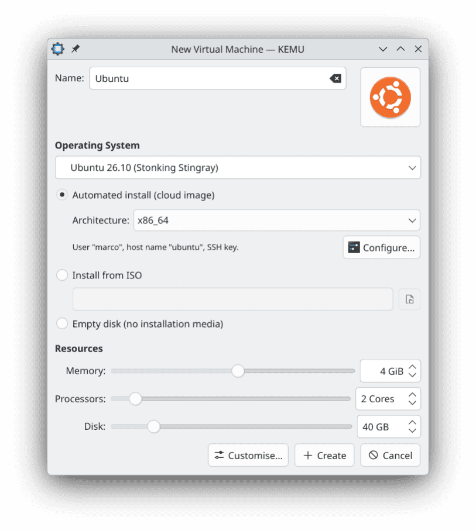
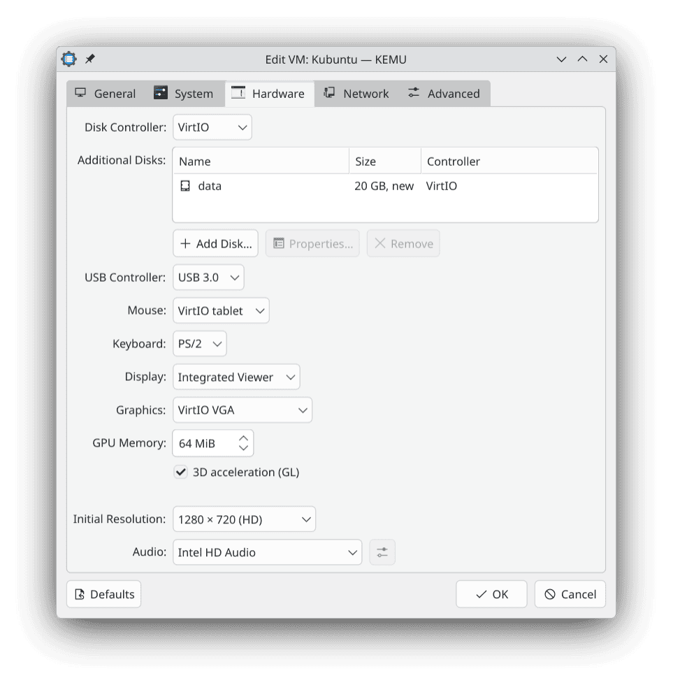

# KEMU – KDE QEMU Virtual Machine Manager

KEMU is a desktop frontend that runs QEMU directly – no libvirt, no daemon, no
root. It is built with Qt 6 Widgets and KDE Frameworks 6 and integrates deeply
with the Plasma desktop.

**Disclaimer:** This project is in early-stage development.

 
 

## Features

**Virtual machines and disks**

- Create VMs from OS templates: install from an ISO image, or deploy a cloud
  image automatically with cloud-init
- Additional disks, expanding and compacting disks, freeing unused blocks
- Snapshots, Save State, linked clones
- Encrypted system disk and TPM state (LUKS), passwords kept in KWallet
- TPM 2.0 (swtpm), UEFI with Secure Boot, editable system identity (UUID,
  SMBIOS)

**Display and devices**

- Integrated viewer (QEMU D-Bus display) with 3D acceleration, audio in both
  directions, clipboard sharing and pointer capture, or QEMU's own SDL window
- Hot-swapping of ISO and floppy images, USB passthrough
- Shared folders via 9p (Linux/BSD) and virtio-fs (Windows)

**Networking**

- User-mode networking per VM, or virtual networks that connect VMs through an
  in-process switch with DHCP, DNS and optional NAT – no root, no bridge, no
  helper process

**Desktop integration**

- System tray icon, desktop notifications
- VMs in the application menu, started like applications of their own
- `kemu --start <vm>` from the command line
- File associations for KEMU archives, OVA files and template packages; a
  Dolphin action to create a VM from a disc image
- QEMU guest agent: host name, address and OS of the guest, clean shutdown,
  freeing blocks, clock sync after host sleep
- Pauses VMs while the host sleeps and keeps the session from ending while VMs
  run

**Portability**

- Each VM is a self-contained directory with `config.json`, its disks and a
  `qemu.sh` start script using relative paths
- Export and import as `.kemu.tar.zst` archives, OVA export and import for
  other tools

## Installation

### Flatpak

The Flatpak bundles QEMU, swtpm and virtiofsd. Build and install it from the
source tree:

```sh
flatpak install flathub org.kde.Platform//6.11 org.kde.Sdk//6.11 \
    org.freedesktop.Sdk.Extension.rust-stable//25.08
flatpak-builder --user --install --force-clean build-dir org.kde.kemu.yml
```

What differs in the sandbox, and how to grant more access, is described in
[docs/flatpak.md](docs/flatpak.md).

### From source

**Requirements:**

- Qt ≥ 6.6 (Core, Gui, Widgets, Network, Svg, DBus, Multimedia, OpenGL) and its
  private headers (`Qt6::GuiPrivate`, for pointer capture under Wayland)
- KDE Frameworks ≥ 6.0: CoreAddons, Config, ConfigWidgets, Crash, DBusAddons,
  I18n, IconThemes, JobWidgets, KIO, Notifications, NotifyConfig,
  StatusNotifierItem, TextTemplate, Wallet, WidgetsAddons, WindowSystem, XmlGui
- QEMU ≥ 7.2
- libarchive, libslirp ≥ 4.7, libisofs, libudev, EGL, Wayland (client library,
  protocols, `wayland-scanner`)

**Optional at runtime:**

- `edk2-ovmf` / `ovmf` – UEFI and Secure Boot
- `swtpm` with `swtpm_ioctl` – TPM 2.0, and encrypted VMs with a TPM
- `virtiofsd` – shared folders with Windows guests

KEMU checks these programs at startup and disables what depends on a missing
one; *Settings → System → Executables* shows what it found.

#### Arch Linux

```sh
sudo pacman -S cmake extra-cmake-modules qt6-base qt6-svg qt6-multimedia \
  kcoreaddons kconfig kconfigwidgets kcrash kdbusaddons ki18n kiconthemes \
  kjobwidgets kio knotifications knotifyconfig kstatusnotifieritem \
  ktexttemplate kwallet kwidgetsaddons kwindowsystem kxmlgui \
  libarchive libslirp libisofs wayland wayland-protocols qemu-full
sudo pacman -S edk2-ovmf swtpm virtiofsd   # optional
```

#### Debian 13+ / (K)Ubuntu 26.04+ / KDE neon

```sh
sudo apt install build-essential cmake extra-cmake-modules \
  qt6-base-dev qt6-base-private-dev qt6-svg-dev qt6-multimedia-dev \
  libkf6coreaddons-dev libkf6config-dev libkf6configwidgets-dev libkf6crash-dev \
  libkf6dbusaddons-dev libkf6i18n-dev libkf6iconthemes-dev libkf6jobwidgets-dev \
  libkf6kio-dev libkf6notifications-dev libkf6notifyconfig-dev \
  libkf6statusnotifieritem-dev libkf6texttemplate-dev libkf6wallet-dev \
  libkf6widgetsaddons-dev libkf6windowsystem-dev libkf6xmlgui-dev \
  libarchive-dev libslirp-dev libisofs-dev libudev-dev libegl1-mesa-dev \
  libwayland-dev wayland-protocols qemu-system
sudo apt install ovmf swtpm swtpm-tools virtiofsd   # optional
```

#### Fedora 40+

```sh
sudo dnf install gcc-c++ cmake extra-cmake-modules \
  qt6-qtbase-devel qt6-qtbase-private-devel qt6-qtsvg-devel qt6-qtmultimedia-devel \
  kf6-kcoreaddons-devel kf6-kconfig-devel kf6-kconfigwidgets-devel kf6-kcrash-devel \
  kf6-kdbusaddons-devel kf6-ki18n-devel kf6-kiconthemes-devel kf6-kjobwidgets-devel \
  kf6-kio-devel kf6-knotifications-devel kf6-knotifyconfig-devel \
  kf6-kstatusnotifieritem-devel kf6-ktexttemplate-devel kf6-kwallet-devel \
  kf6-kwidgetsaddons-devel kf6-kwindowsystem-devel kf6-kxmlgui-devel \
  libarchive-devel libslirp-devel libisofs-devel systemd-devel mesa-libEGL-devel \
  wayland-devel wayland-protocols-devel qemu-system-x86 qemu-img
sudo dnf install edk2-ovmf swtpm swtpm-tools virtiofsd   # optional
```

#### Build, install, uninstall

Build and run from the build directory:

```sh
cmake -B build -DCMAKE_BUILD_TYPE=Debug
cmake --build build
./build/bin/kemu
```

Install for the current user (no root needed; `~/.local/bin` must be in
`$PATH`):

```sh
cmake -B build -DCMAKE_BUILD_TYPE=Release -DCMAKE_INSTALL_PREFIX=~/.local
cmake --build build --target install
```

Install system-wide (usually under `/usr/local`), and uninstall again:

```sh
cmake -B build -DCMAKE_BUILD_TYPE=Release
sudo cmake --build build --target install
sudo cmake --build build --target uninstall
```

Pointer capture uses one private Qt header to reach the Wayland surface of the
viewer window; there is no public API for it. KEMU therefore has to be rebuilt
after a Qt minor version upgrade.

## Using KEMU

### Creating virtual machines

*New Virtual Machine…* offers the operating systems of the template database.
A template sets sensible hardware defaults and, where the distribution offers
one, a cloud image: KEMU downloads it and installs the guest unattended with
cloud-init, using the user, SSH keys, locale and keyboard from *Settings →
Deployment*. Alternatively install from an ISO image or start with a blank
disk. In Dolphin, *New Virtual Machine from This Image…* on a disc image opens
the dialog with that image selected.

Templates are managed under *Settings → Templates*; their format is described
in [docs/templates.md](docs/templates.md).

### Display

Each VM uses one of two display backends:

| Backend   | Window              | 3D acceleration | Audio            | Clipboard |
| --------- | ------------------- | --------------- | ---------------- | --------- |
| **D-Bus** | KEMU's viewer       | Yes (Virtio)    | Through the viewer | Yes     |
| **SDL**   | QEMU's own window   | Yes (Virtio)    | System (PipeWire)  | No      |

Closing the viewer keeps the VM running headless; *Show Display* opens it
again. Clipboard sharing needs the SPICE vdagent in the guest. Details, and a
workaround for Wayland guests, are in [docs/display.md](docs/display.md).

### Networking

| Mode                | VM-to-VM | DHCP     | NAT      | Port forwarding |
| ------------------- | -------- | -------- | -------- | --------------- |
| **User mode**       | No       | Yes      | Yes      | Yes             |
| **Virtual network** | Yes      | Optional | Optional | Yes             |

Both run in userspace without root. Virtual networks are defined under
*Settings → Virtual Networks*; see [docs/networking.md](docs/networking.md).

### Shared folders

A host folder is shared with the guest via 9p on Linux and BSD guests and via
virtio-fs on Windows guests (`virtiofsd` on the host, VirtIO drivers and WinFsp
in the guest). The *Shared Name* is the mount tag in the guest, e.g. on Linux:

```sh
sudo mount -t 9p -o trans=virtio,version=9p2000.L exchange /mnt/shared
```

More guests, fstab entries and Windows setup:
[docs/shared-folders.md](docs/shared-folders.md).

### Disks and snapshots

- The system disk is a qcow2 image; additional disks are added under
  *Edit… → Hardware → Additional Disks*, empty or copied from an existing image.
- Disks can be expanded in the VM settings. Blocks the guest frees are
  released on the host whenever it trims its file systems; *Disk Space → Free
  Unused Blocks* trims at once through the guest agent. *Compact System Disk*
  rewrites the image without unused blocks and snapshots.
- Snapshots cover all disks, with or without the running state.
- A **linked clone** stores only its own changes on top of the source's disks;
  the source is frozen while clones depend on it.
- The **system disk and TPM state can be encrypted** (LUKS) when creating a VM
  or later in its settings. Without the password the data cannot be
  recovered.

Details and limits: [docs/storage.md](docs/storage.md).

### QEMU guest agent

Every VM with a PCI bus has a channel for the QEMU guest agent
(*Edit… → Advanced → Connect the QEMU guest agent*, on by default). In the
guest it comes with the
`qemu-guest-agent` package on Linux and with the virtio-win guest tools on
Windows; cloud-init deployments install it where possible. While the agent
answers:

- the line below the VM's status shows the guest's host name, first IP
  address (click to copy) and operating system, and the VM list shows the
  address next to the uptime,
- *Shut Down* goes through the agent, which also works when the guest ignores
  the ACPI power button,
- *Free Unused Blocks* trims the guest's file systems,
- the guest clock is set after resume, after host sleep and after reverting to
  a live snapshot.

KEMU talks to the agent through a socketpair; no socket file exists that other
processes could use. It never uses the agent's commands to run programs or read
files in the guest.

### Desktop integration

- **System tray** – *Settings → Appearance → Enable system tray icon*. A click
  shows or hides the main window; the menu lists the running VMs and starts
  stopped ones. Closing the main window then keeps KEMU and its VMs running;
  *Quit* ends it. *Start minimized to tray* starts KEMU with only the icon.
- **Notifications** – for events in the background: a VM shut down or stopped
  unexpectedly, a saved state, VMs resumed after host sleep, deployment
  results, freed blocks, a linked clone made independent, a pending host
  shutdown. Configure them under *Settings → Configure Notifications…*. Long
  jobs such as export, import, cloning or compaction report through Plasma's
  job progress.
- **Application menu** – *VM → Add to Application Menu* adds an entry that
  starts the VM like an application of its own; it can be pinned to the task
  manager. The entry follows renames and is removed with the VM.
- **Command line** – `kemu --start <vm> [--headless]` starts a VM, given by
  name or UUID, without opening the main window (hidden in the tray, or
  minimized). KEMU then ends with that VM, unless the main window was opened or
  another VM started meanwhile. A running KEMU takes the request over.
  `kemu --new-vm <image>` opens the new VM dialog for a disc image, and
  `kemu <file>` imports archives, OVA files and template packages.
- **File associations** – `.kemu.tar.zst` archives and OVA files open in KEMU
  and are imported; `.kemu-template.tar.gz` packages open on the Templates
  settings page.

### Shutting down the host with a guest

KEMU can shut down the host once a guest has powered itself off, e.g. after a
long update. Set it per VM (*Edit… → System → When the guest shuts down*) or for
the current run (*Shut Down Host with Guest* in the VM menu or the viewer).
Only a power-off by the guest counts, and only if no other VM is running or
busy; a 30-second countdown allows cancelling. On Plasma the session ends
properly, elsewhere KEMU asks logind (polkit may ask for a password).

### USB passthrough

USB devices can be attached to running VMs. QEMU needs read/write access to
`/dev/bus/usb/BUS/DEVICE`, for example through a udev rule and membership in
the `kvm` group:

```udev
# /etc/udev/rules.d/90-qemu-usb.rules
SUBSYSTEM=="usb", MODE="0664", GROUP="kvm"
```

Then run `sudo udevadm control --reload-rules && sudo udevadm trigger`.

**Security warning:** This rule gives the `kvm` group access to all USB
devices, including keyboards and private drives. Better restrict it to the
devices you pass through:

```udev
SUBSYSTEM=="usb", ATTR{idVendor}=="0951", ATTR{idProduct}=="1666", MODE="0664", GROUP="kvm"
```

### System identity

Every new VM gets a random system UUID. Under
*Edit… → Advanced → System Identity* the UUID and the SMBIOS system information
can be changed. VMs from older KEMU
versions have no UUID; KEMU does not assign one on its own, because a changed
identity can affect software licensing and Windows activation. Clones get a
UUID of their own (unless the source has none), imported archives keep theirs
unless the source VM still exists, OVA imports get a new one.

### Import and export

*Export…* writes a `.kemu.tar.zst` archive with everything a VM needs –
the way to move or back up VMs between KEMU installations. OVA files are read
and written for exchange with other tools, with some limits on hardware
details; see [docs/import-export.md](docs/import-export.md).

## Troubleshooting

### Debug logging

| Category                   | Covers                                                                |
| -------------------------- | --------------------------------------------------------------------- |
| `org.kde.kemu`             | Application, VM lifecycle, networking, QMP, guest agent, snapshots    |
| `org.kde.kemu.dbusdisplay` | Integrated D-Bus viewer (frame-level traffic)                         |

Only warnings are printed by default. To get everything for a bug report:

```sh
QT_LOGGING_RULES="org.kde.kemu*=true" kemu 2>&1 | tee kemu.log
```

With `kdebugsettings` installed, the categories can also be switched there.

### File locations

| Purpose                  | Path                                             |
| ------------------------ | ------------------------------------------------ |
| Virtual machines         | `~/.local/share/kemu/vms/`                       |
| Own OS templates         | `~/.local/share/kemu/data/templates.d/`          |
| Own cloud-init templates | `~/.local/share/kemu/data/cloud-init-templates/` |
| Downloaded templates     | `~/.local/share/kemu/ghns/`                      |
| Configuration            | `~/.config/kemurc`                               |

The Flatpak keeps these under `~/.var/app/org.kde.kemu/`. Each VM directory
holds `config.json`, `disk.qcow2` (further disks as `disk-2.qcow2`, …),
`OVMF_VARS.fd` for UEFI VMs and `qemu.sh`. The storage location can be changed
under *Settings → Virtual Machines*.

### UEFI firmware

KEMU finds the OVMF firmware of the common distributions on its own; a
directory set under *Settings → System → UEFI Firmware* is searched first.

| Distribution  | Package            | Typical Secure Boot firmware                  |
| ------------- | ------------------ | --------------------------------------------- |
| Arch Linux    | `edk2-ovmf`        | `/usr/share/edk2/x64/OVMF_CODE.secboot.4m.fd` |
| Debian/Ubuntu | `ovmf`             | `/usr/share/OVMF/OVMF_CODE_4M.secboot.fd`     |
| Fedora        | `edk2-ovmf`        | `/usr/share/edk2/ovmf/OVMF_CODE.secboot.fd`   |
| openSUSE      | `qemu-ovmf-x86_64` | `/usr/share/qemu/ovmf-x86_64-smm-ms-code.bin` |

Each UEFI VM keeps its NVRAM in its own `OVMF_VARS.fd`, created from the
matching template when needed; an existing file is never replaced.

### Screenshots of 3D-accelerated VMs

*Save Screenshot…* uses QEMU's `screendump`, which reads the software
framebuffer. With Virtio-GL the image is rendered on the host GPU instead, so
switch the display to VGA or VirtIO without 3D for screenshots.

### QEMU sandbox

*Settings → System → QEMU Sandbox* starts QEMU with its seccomp filter
(`-sandbox on,obsolete=deny,elevateprivileges=deny,spawn=deny,resourcecontrol=deny`),
so a guest that breaks into QEMU can neither start programs nor change
privileges. Options that make QEMU spawn helpers (`-netdev tap,script=…`,
`smb=`) do not work under it, and a feature that needs a blocked call ends QEMU
with SIGSYS. A `-sandbox` in a VM's extra arguments always takes precedence.

## Known limitations

- Additional disks are qcow2 images inside the VM directory; host block
  devices cannot be attached directly. Disks cannot be added or removed while
  the VM runs.
- Pointer capture in the viewer needs a Wayland session; guests with a tablet
  pointer work everywhere.
- NAT in virtual networks is IPv4 only and does not translate ping.
- Encrypted VMs cannot save their state, and snapshots of them are taken while
  they are shut down.

## Credits and trademarks

KEMU builds on QEMU (Fabrice Bellard and the QEMU Project developers), swtpm
and libtpms, virtiofsd, libslirp, libisofs, libarchive, EDK II/OVMF and
cloud-init. Operating system icons come from the
[Papirus Icon Theme](https://github.com/PapirusDevelopmentTeam/papirus-icon-theme)
(GPL-3.0); the QEMU logo is by Benoît Canet (CC BY 3.0). The full list is in
*Help → About KEMU*.

Trademarks, logos and brand names are the property of their respective owners.
Third-party logos in KEMU only identify the operating system of a virtual
machine. KEMU is an independent open-source project and is not affiliated
with, endorsed by or sponsored by any trademark holder.

## License

KEMU is licensed under GPL-3.0-or-later, its documentation (this README and
`docs/`) under CC-BY-SA-4.0.
