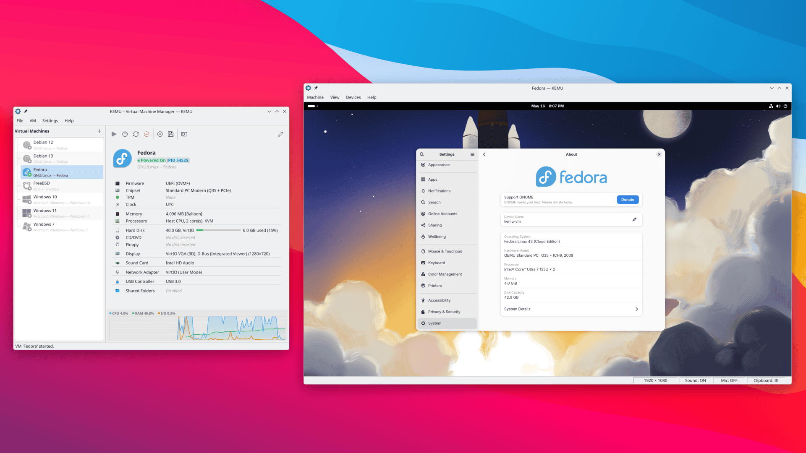
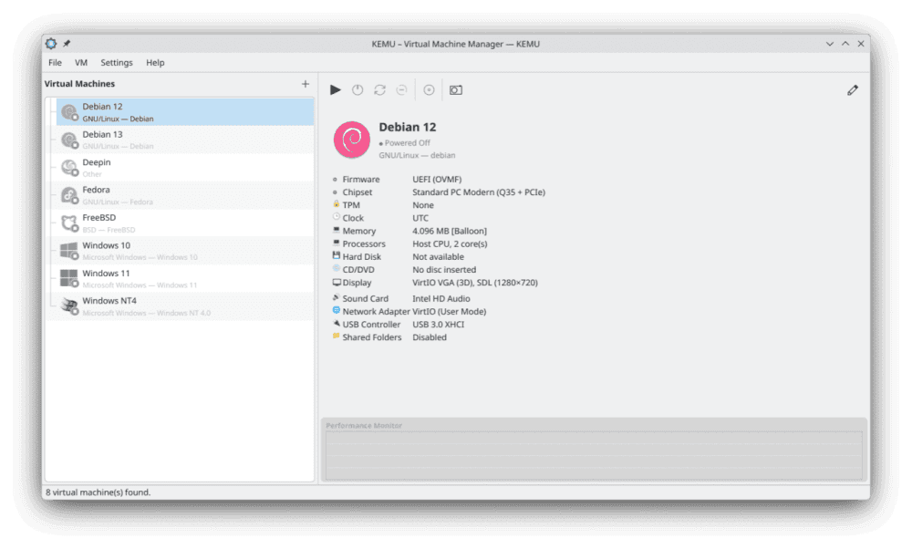
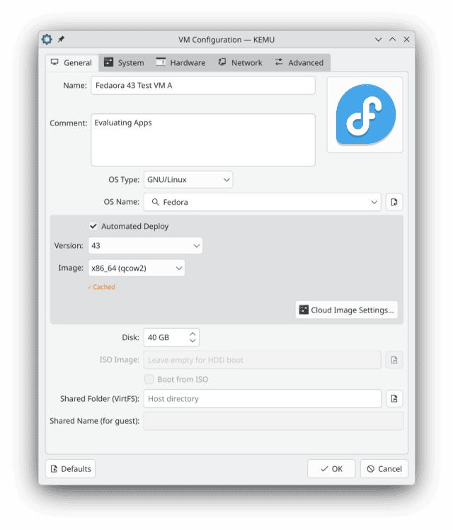
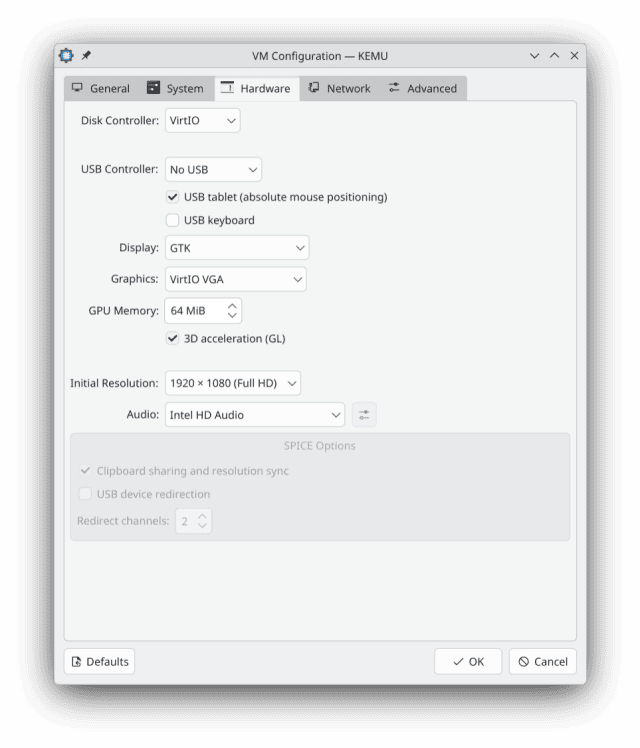
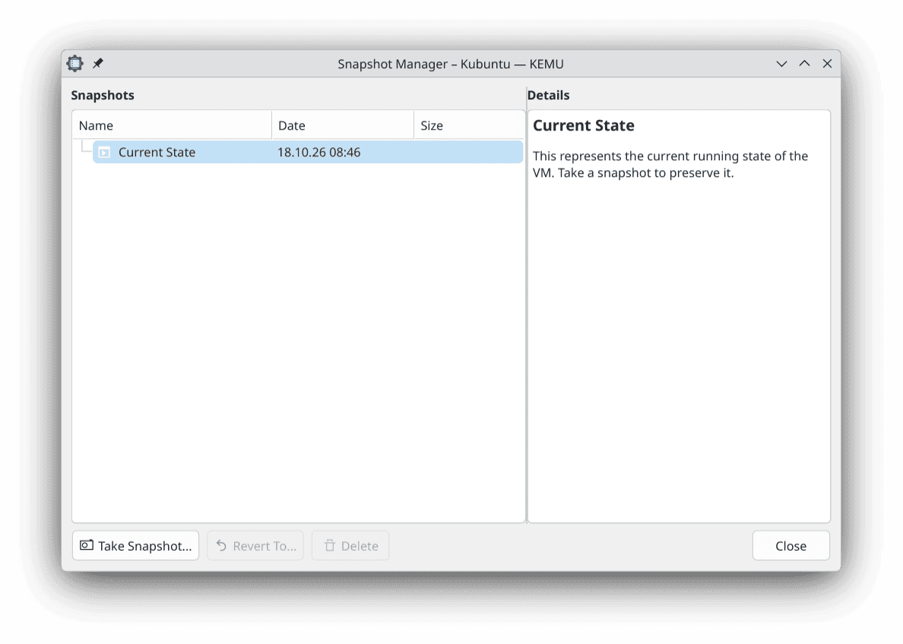

<!--
SPDX-FileCopyrightText: 2026 Marco Nelles <marco@maniatek.de>

SPDX-License-Identifier: GPL-3.0-or-later
-->

# KEMU – KDE QEMU Virtual Machine Manager

A traditional, direct-to-QEMU desktop frontend for Linux, built with Qt6 Widgets and KDE Frameworks 6 for deep desktop integration.

**Disclaimer:** Early-stage development.

## Features

- Create, edit, and delete QEMU virtual machines
- Supports display types GTK, SDL, SPICE (via `virt-viewer (remote-viewer)`)
- Integrated D-Bus viewer with audio and clipboard sharing (**experimental**)
- Automated Deploy feature (Cloud-Init support)
- Snapshot support (QCOW2)
- Hot-swap ISO and Floppy images
- Networking: User-mode networking via passt, or rootless virtual networks within Linux user namespaces
- Shared folders via 9p/VirtFS (Linux/BSD) and virtio-fs (Windows)
- VMs stored as portable directories with `config.json` + `disk.qcow2` + `qemu.sh` start script with relative paths
- Export and import VMs as compressed archives (`.kemu.tar.zst`) for backup or migration
- OVA export and import (limited) for interoperability

## Limitations

- Currently limited to a single storage drive per VM

## Gallery







## Dependencies

- Qt 6
- KDE Frameworks 6
- QEMU >= 7.2
- libarchive
- passt (for user-mode networking and virtual network NAT)
- libmnl (minimalistic netlink library for virtual networks)
- libnftnl (nftables netlink helpers for virtual networks)
- libudev (for usb device passthrough)
- Optional: `edk2-ovmf` (for UEFI boot)
- Optional: `swtpm` (for TPM 2.0 emulation)
- Optional: `virtiofsd` (for shared folders with Windows guests)
- Optional: `dnsmasq` (for DHCP in virtual networks)
- Optional: `virt-viewer (remote-viewer)` (for SPICE support)
- Optional: `dbus-daemon` (for the integrated D-Bus display viewer)

### Arch Linux

```bash
sudo pacman -S qt6-base qt6-declarative extra-cmake-modules \
  kconfig kcoreaddons ki18n kxmlgui kwidgetsaddons kdbusaddons \
  kiconthemes qemu-full edk2-ovmf libarchive passt libmnl libnftnl
```

Optional:

```bash
sudo pacman -S swtpm virtiofsd dnsmasq virt-viewer dbus cdrtools
```

### Debian 13+ / (K)Ubuntu 26.04+ / KDE neon

```bash
sudo apt install qt6-base-dev qt6-declarative-dev qt6-svg-dev qt6-multimedia-dev \
  libkf6config-dev libkf6coreaddons-dev libkf6i18n-dev libkf6kio-dev \
  libkf6crash-dev libkf6xmlgui-dev libkf6widgetsaddons-dev libkf6iconthemes-dev \
  libkf6texttemplate-dev qemu-system extra-cmake-modules libegl1-mesa-dev \
  libarchive-dev passt libmnl-dev libnftnl-dev libudev-dev libkf6dbusaddons-dev \
  build-essential cmake
```

Optional:

```bash
sudo apt install ovmf swtpm virtiofsd dnsmasq virt-viewer dbus-daemon genisoimage
```

### Fedora 40+

```bash
sudo dnf install qt6-qtbase-devel qt6-qtdeclarative-devel qt6-qtsvg-devel \
  qt6-qtmultimedia-devel kf6-kconfig-devel kf6-kcoreaddons-devel kf6-ki18n-devel \
  kf6-kio-devel kf6-kcrash-devel kf6-kxmlgui-devel kf6-kwidgetsaddons-devel \
  kf6-kiconthemes-devel kf6-ktexttemplate-devel kf6-kdbusaddons-devel \
  extra-cmake-modules qemu-system-x86 mesa-libEGL-devel libarchive-devel passt \
  libmnl-devel libnftnl-devel systemd-devel gcc-c++ make cmake
```

Optional:

```bash
sudo dnf install edk2-ovmf swtpm virtiofsd dnsmasq virt-viewer dbus-daemon genisoimage
```

## Building and running

To **compile** (and run):

```bash
cmake -DCMAKE_VERBOSE_MAKEFILE=ON -DCMAKE_BUILD_TYPE=Debug -B build/
cmake --build build/
cd build/bin
./kemu
```

### Local Installation (Recommended for testing)

**Installs** KEMU to your user's **home directory** (~/.local). This requires no root privileges.

```bash
cmake -DCMAKE_BUILD_TYPE=Release -DCMAKE_INSTALL_PREFIX=~/.local -B build/
cmake --build build/ --target install
```

Note: Ensure ~/.local/bin is in your system's `$PATH`.

### System-wide Installation

**Installs** KEMU **system-wide** for all users (usually under /usr/local/).

```bash
cmake -DCMAKE_BUILD_TYPE=Release -B build/
sudo cmake --build build/ --target install
```

To **uninstall**:

```bash
(sudo) make uninstall
```

## Debug Logging

KEMU uses Qt logging categories. Two categories are defined:

| Category                    | Covers                                                 |
|-----------------------------|--------------------------------------------------------|
| `org.kde.kemu`              | Main application, VM lifecycle, QMP, snapshots, etc.   |
| `org.kde.kemu.dbusdisplay`  | Integrated D-Bus display viewer (frame-level traffic)  |

Only warnings and critical messages are printed by default. To enable debug output for a single run:

```bash
QT_LOGGING_RULES="org.kde.kemu.debug=true" kemu
QT_LOGGING_RULES="org.kde.kemu*=true" kemu # both categories
```

If `kdebugsettings` is installed, KEMU's categories will appear there and can be toggled with a GUI.

When filing a bug report, please attach the debug output:

```bash
QT_LOGGING_RULES="org.kde.kemu*=true" kemu 2>&1 | tee kemu.log
```

## File Locations

| Purpose                              | Path                             |
|--------------------------------------|----------------------------------|
| VM data                              | `~/.local/share/kemu/vms/`       |
| Cloud Image DB, Cloud-Init templates | `~/.local/share/kemu/data/`      |
| Configuration                        | `~/.config/kemurc`               |

Each VM is stored as a subdirectory containing `config.json`, `disk.qcow2`, `OVMF_VARS.fd` (optionally) and `qemu.sh`.

## Secure Boot Firmware Package Names

| Distro            | Package            | Typical OVMF path                             |
|-------------------|--------------------|-----------------------------------------------|
| **Arch Linux**    | `edk2-ovmf`        | `/usr/share/edk2/x64/OVMF_CODE.secboot.4m.fd` |
| **Debian/Ubuntu** | `ovmf`             | `/usr/share/OVMF/OVMF_CODE_4M.secboot.fd`     |
| **Fedora**        | `edk2-ovmf`        | `/usr/share/edk2/ovmf/OVMF_CODE.secboot.fd`   |
| **openSUSE**      | `qemu-ovmf-x86_64` | `/usr/share/qemu/ovmf-x86_64-smm-ms-code.bin` |

## Display Backends

KEMU supports four display backends, selectable per VM in the VM settings:

| Backend          | Window           | 3D Acceleration | Audio Routing      | Clipboard Sharing | External Process |
|------------------|------------------|-----------------|--------------------|-------------------|------------------|
| **GTK**          | QEMU built-in    | Yes (Virtio)    | System (PipeWire)  | No                | None             |
| **SDL**          | QEMU built-in    | Yes (Virtio)    | System (PipeWire)  | No                | None             |
| **SPICE**        | `remote-viewer`  | No              | System (PipeWire)  | Via SPICE agent   | `virt-viewer`    |
| **D-Bus**        | KEMU integrated  | Yes (Virtio)    | Routed via D-Bus   | Yes (built-in)    | `dbus-daemon`    |

GTK and SDL are the simplest options - QEMU opens its own window directly, with optional OpenGL passthrough for hardware-accelerated graphics. SPICE adds remote-display capability and SPICE-agent integration but requires the external `virt-viewer` package and offers no 3D acceleration. The D-Bus backend combines the strengths of both: hardware-accelerated rendering inside a viewer window managed by KEMU itself, with audio and clipboard sharing built in.

### D-Bus Display

> **Highly Experimental:** The D-Bus display backend is under active development and should be considered unstable. Expect bugs, missing features, and breaking changes between versions. Not recommended for production use.

The D-Bus display backend embeds the VM's framebuffer directly into a KEMU-managed Qt window. It uses QEMU's `-display dbus` interface to receive video, send keyboard and mouse events, and exchange audio and clipboard data - all over a private D-Bus session per VM.
Each D-Bus VM gets its own isolated `dbus-daemon` instance with a private socket inside the VM directory. KEMU and QEMU connect as clients to this private bus and exchange D-Bus messages directly.

**Features:**

- **Hardware-accelerated graphics**: When the VM uses Virtio-GPU with 3D acceleration, frames are passed as DMA-BUF descriptors over D-Bus and imported directly into the viewer's OpenGL context - zero-copy, GPU-to-GPU.
- **Bidirectional audio**: Playback (host speakers) and capture (host microphone) routed through D-Bus to QEMU's `audiodev=dbus` backend, using PipeWire on the host side via Qt Multimedia.
- **Clipboard synchronization**: Toggle between off, guest->host, host->guest, or <->bidirectional in the viewer's Devices menu. Requires a clipboard agent in the guest (e.g. `qemu-guest-agent` with the appropriate addon, or the SPICE vdagent which works on the D-Bus interface as well).
- **Reconnect support**: Closing the viewer window switches the VM to headless mode instead of terminating it. Reconnect later via the VM context menu.

**Requirements:**

- `dbus-daemon` must be installed on the host. KEMU detects this at startup and disables the D-Bus display option if missing.
- The guest needs no special drivers for video or input - QEMU handles everything on its side. For clipboard and SPICE-agent features, install the standard SPICE vdagent in the guest.

## Networking

KEMU offers two network modes, both running entirely in userspace without root privileges.

| Mode                  | Backend                               | VM-to-VM | DHCP             | NAT            | Port Forwarding |
|-----------------------|---------------------------------------|----------|------------------|----------------|-----------------|
| **User Mode (passt)** | `passt`                               | No       | N/A (host stack) | Yes            | Yes             |
| **Virtual Network**   | User namespaces + `pasta` + `dnsmasq` | Yes      | Yes (optional)   | Yes (optional) | Yes             |

### User Mode (passt) - Default

Each VM gets its own isolated network connection through `passt`, which translates between the VM's network stack and the host's. This is the simplest mode and requires no additional setup. Port forwarding rules can be configured per VM to expose guest services on the host.

### Virtual Network

Virtual networks connect multiple VMs to a shared private subnet. The entire stack runs rootless using Linux user namespaces.

```
┌─── User Namespace ───────────────────────────────┐
│                                                  │
│   br0  (bridge, e.g. 192.168.100.1/24)           │
│    ├── tap-vm1 :: QEMU VM1                       │
│    ├── tap-vm2 :: QEMU VM2                       │
│    └── ...                                       │
│                                                  │
│   [dnsmasq]  (optional DHCP on br0)              │
│                                                  │
└──────────────────────────────────────────────────┘
         │
      [pasta]  (optional NAT to host network)
```

Each virtual network creates an isolated Linux network namespace containing a bridge. VMs attach to the bridge via tap devices and can communicate directly at layer 2. QEMU processes are launched inside the namespace so they can see the tap devices.

**Features per network (individually configurable):**

- **DHCP** (via `dnsmasq`): Automatically assigns IP addresses to VMs. Can be disabled for static IP setups or Cloud-Init deployments.
- **NAT** (via `pasta`): Provides internet access to VMs by translating traffic between the namespace and the host network. When disabled, the network is fully air-gapped.
- **Port forwarding**: Expose specific ports from the virtual network on the host.

**Requirements:**

- Unprivileged user namespaces must be enabled (`kernel.unprivileged_userns_clone=1`, the default on most distributions). KEMU checks this at startup and disables the virtual network feature if unsupported.
- `dnsmasq` must be installed for DHCP. Without it, VMs need static IPs (manual or via Cloud-Init).
- `pasta` (part of the `passt` package) must be installed for NAT. Without it, virtual networks are isolated from the internet.

**Automatic cleanup:** When all VMs disconnect from a virtual network, KEMU stops the network. Killing the namespace anchor process causes the kernel to automatically destroy all interfaces, bridges, and routes - no manual cleanup or leftover state.

**Shared folders:** Since QEMU runs as mapped root inside the namespace, 9p shared folders use `mapped-xattr` security model automatically (instead of `none` in user mode). See the [Shared Folders](#shared-folders) section for details.

**Debugging:** Click the namespace PID in the VM details panel to copy it, then enter the namespace from any terminal:

```bash
nsenter -t <PID> -U --preserve-credentials -n -- /bin/bash
```

From this shell you have full access to all VMs on the virtual network.

## Shared Folders

KEMU enables host-guest file exchange via the following protocols:

| Guest OS      | Protocol    | Host Daemon | Guest Software          |
|---------------|-------------|-------------|-------------------------|
| **Linux/BSD** | 9p (VirtFS) | None        | Native kernel support   |
| **Windows**   | virtio-fs   | `virtiofsd` | VirtIO drivers + WinFsp |

Configuration in VM specs. The *Shared Name* acts as the mount tag in the guest.

> **Note on Virtual Networks:** When a VM runs on a virtual network, QEMU executes inside a user namespace with mapped root privileges. KEMU handles this automatically by adjusting the 9p security model (see Linux section below). Windows guests using virtio-fs are not affected, as `virtiofsd` runs on the host outside the namespace.

### Linux & BSD Guests

Mounting via 9p (Example: tag `exchange` to `/mnt/shared`).

* **Linux:**
    ```bash
    sudo mount -t 9p -o trans=virtio exchange /mnt/shared
    ```
    *fstab:* `exchange /mnt/shared 9p trans=virtio,version=9p2000.L,rw,nofail 0 0`

> **Virtual Network Mode:** VMs on a virtual network run inside a user namespace where QEMU sees itself as root (UID 0). KEMU automatically switches to `security_model=mapped-xattr` for these VMs, which stores guest file ownership in extended attributes on the host. This works transparently in most cases. If you encounter permission issues in the guest, mount with `access=any`:
> ```bash
> sudo mount -t 9p -o trans=virtio,version=9p2000.L,access=any exchange /mnt/shared
> ```

* **FreeBSD (13+):**
    ```bash
    sudo mount -t virtfs -o trans=virtio exchange /mnt/shared
    ```
    *fstab:* `exchange /mnt/shared virtfs trans=virtio,rw 0 0`

> **Note:** OpenBSD/NetBSD support is limited. Check first. The virtual network mode note above applies to all Unix guests using 9p.

### Windows Guest

Requires `virtio-fs`. On the host side, KEMU starts `virtiofsd` automatically.

Installation order is critical:

1.  **Install WinFsp** ([winfsp.dev](https://winfsp.dev/rel/)).
2.  **Install VirtIO Guest Tools** (Run `virtio-win-gt-x64.msi`).
3.  **Reboot.**

If the drive doesn't appear, fix the service via PowerShell:

```powershell
# Check if the service is running:
Get-Service VirtioFsSvc

# Start it manually if stopped:
Start-Service VirtioFsSvc

# Set it to start automatically on boot:
sc.exe config VirtioFsSvc start=auto
```

## Screenshots

KEMU uses QEMU's screendump command to capture VM screenshots via the software framebuffer. However, VirtIO-GL offloads rendering to the host GPU, bypassing this framebuffer. To enable screenshots, use `VGA` or `standard VirtIO` instead.

## USB Passthrough

KEMU allows hot-plugging USB devices into running virtual machines. QEMU requires read/write access to `/dev/bus/usb/BUS/DEVICE`.

To allow access create an udev rule (recommended):

```
# /etc/udev/rules.d/90-qemu-usb.rules
SUBSYSTEM=="usb", MODE="0664", GROUP="kvm"
```
Then add the user to the kvm group. Reload with `sudo udevadm control --reload-rules && sudo udevadm trigger`.

Security Warning: This rule grants the kvm group full access to all host USB devices (including your keyboard or private drives). For better security, restrict access to specific devices using their Vendor/Product IDs as shown below:

```
# Kingston DataTraveler flash drive (example IDs)
SUBSYSTEM=="usb", ATTR{idVendor}=="0951", ATTR{idProduct}=="1666", MODE="0664", GROUP="kvm"
```

## OVA Import/Export Limitations

- OVA support is limited to single-disk VMs; multi-disk configurations are not handled
- UEFI, TPM, and Secure Boot settings cannot be represented in the OVA format and will be lost on export
- Snapshots are not preserved during OVA export (VMDK does not support them)
- The shared folder path and ISO path are stripped from native exports as they are system-specific
- OVF parsing covers common VirtualBox/VMware OVAs but may not handle some exotic configurations

## Credits and Trademarks

**Third-Party Assets:**
Operating system icons used within KEMU are provided by the [Papirus Icon Theme](https://github.com/PapirusDevelopmentTeam/papirus-icon-theme), licensed under the GPL-3.0.

**Trademark Disclaimer:**
Any trademarks, logos, and brand names used in this software are the property of their respective owners. The use of third-party logos within the KEMU user interface is for identification and descriptive purposes only to represent the guest operating system of a virtual machine.

KEMU is an independent open-source project and is not affiliated with, endorsed by, or sponsored by any mentioned trademark holder.

## License

GPL-3.0
