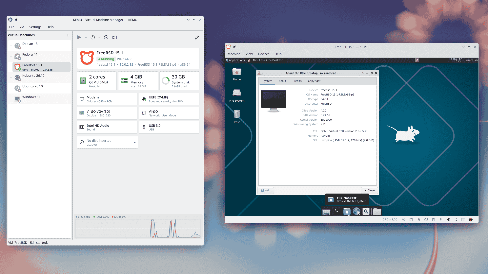
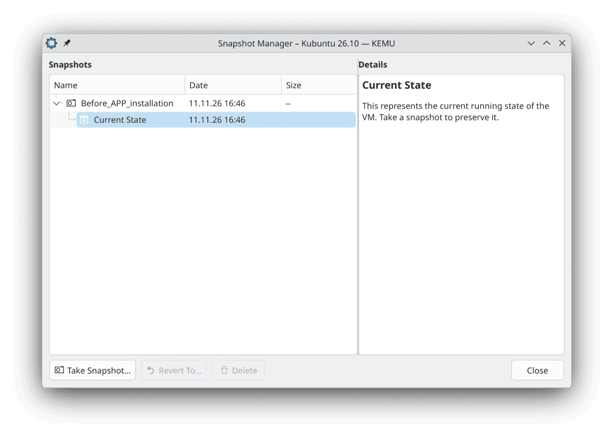

# KEMU – KDE QEMU Virtual Machine Manager

KEMU is a desktop frontend for QEMU that runs virtual machines directly—without libvirt, background daemons, or root privileges. Built with Qt 6 Widgets and KDE Frameworks 6, it integrates tightly with the Plasma desktop.

**Development status:** KEMU is under active development.

KEMU requires a native Wayland session on the host; X11 and XWayland cannot be used as host display backends (guest operating systems can still use X11).

 
 


## Features

**Virtual machines and disks**

- Create VMs from OS templates: install from ISO images or deploy cloud images automatically via cloud-init
- Add disks, expand or compact disk images, and reclaim unused space
- Snapshots, saved states, and linked clones
- LUKS encryption for the system disk and TPM state, with passwords stored in KWallet
- TPM 2.0 (`swtpm`), UEFI with Secure Boot, and editable system identity (UUID, SMBIOS)

**kemu-agent – KEMU's own guest agent for Linux guests**

- Shares the clipboard with the host (optionally files)
- Reports the guest's monitor arrangement
- Works on Wayland and X11 desktops (replacing `spice-vdagent`, but `qemu-guest-agent` keeps running alongside it)
- Ships with KEMU: *Insert kemu-agent CD Image…* puts it into a running VM (`install.sh` and `uninstall.sh`)

**Display and devices**

- Integrated QEMU viewer
- Experimental second monitor in a separate window
- Hot-swapping of ISO and floppy images
- USB passthrough
- Shared folders via 9p (Linux/BSD) and virtio-fs (Windows)

**Networking**

- Per-VM user-mode networking, or virtual networks connecting VMs through an in-process switch with DHCP, DNS, and optional NAT—no root privileges, bridges, or helper processes required

**Desktop integration**

- System tray icon and desktop notifications
- Launch VMs directly from the application menu like native applications
- Command-line startup via `kemu --start <vm>`
- File associations for KEMU archives, OVA files, and template packages, plus a Dolphin action to create a VM from a disc image
- QEMU guest agent integration
- Pauses VMs on host sleep and prevents the session from ending while VMs are running

**Portability**

- Self-contained VM directories with `config.json`, disk images, and a `qemu.sh` start script using relative paths
- Import and export `.kemu.tar.zst` archives, or exchange OVA files with other tools

## Installation

### Flatpak

The Flatpak bundles QEMU, swtpm, and virtiofsd. To build and install it from source:

```sh
flatpak install flathub org.kde.Platform//6.11 org.kde.Sdk//6.11 \
    org.freedesktop.Sdk.Extension.rust-stable//25.08
flatpak-builder --user --install --force-clean build-dir org.kde.kemu.yml
```

For sandbox-specific behaviour and additional permissions, see [docs/flatpak.md](docs/flatpak.md).

### From source

**Requirements:**

- Qt ≥ 6.8 (Core, Gui, Widgets, Network, Svg, DBus, Multimedia, OpenGL) and its private headers
- Qt Wayland platform plugin (required at runtime)
- KDE Frameworks ≥ 6.13: CoreAddons, Config, ConfigWidgets, Crash, DBusAddons, I18n, IconThemes, JobWidgets, KIO, Notifications, NotifyConfig, StatusNotifierItem, TextTemplate, Wallet, WidgetsAddons, WindowSystem, XmlGui
- QEMU ≥ 7.2 with the D-Bus display (and Wayland-enabled SDL for running exported `qemu.sh` scripts)
- libarchive, libslirp ≥ 4.7, libisofs, libudev, EGL, Wayland (client library, protocols, `wayland-scanner`)
- Podman or Docker - builds kemu-agent, the agent for Linux guests, in a container (not needed with `-DKEMU_AGENT_BUNDLE=OFF`; see below)

**Optional runtime dependencies:**

- `edk2-ovmf` / `ovmf` – UEFI and Secure Boot
- `swtpm` with `swtpm_ioctl` – TPM 2.0 and encrypted VMs with a TPM
- `virtiofsd` – shared folders for Windows guests

KEMU detects these programs at startup and disables features whose dependencies are missing. Results appear under *Settings → System → Executables*.

#### Arch Linux

```sh
sudo pacman -S cmake extra-cmake-modules qt6-base qt6-svg qt6-multimedia \
  kcoreaddons kconfig kconfigwidgets kcrash kdbusaddons ki18n kiconthemes \
  kjobwidgets kio knotifications knotifyconfig kstatusnotifieritem \
  ktexttemplate kwallet kwidgetsaddons kwindowsystem kxmlgui \
  libarchive libslirp libisofs wayland wayland-protocols qt6-wayland qemu-full podman
sudo pacman -S edk2-ovmf swtpm virtiofsd   # optional
```

#### Debian 13+ / (K)Ubuntu 26.04+ / KDE neon

```sh
sudo apt install build-essential cmake extra-cmake-modules \
  qt6-base-dev qt6-base-private-dev qt6-wayland-dev qt6-svg-dev qt6-multimedia-dev \
  libkf6coreaddons-dev libkf6config-dev libkf6configwidgets-dev libkf6crash-dev \
  libkf6dbusaddons-dev libkf6i18n-dev libkf6iconthemes-dev libkf6jobwidgets-dev \
  libkf6kio-dev libkf6notifications-dev libkf6notifyconfig-dev \
  libkf6statusnotifieritem-dev libkf6texttemplate-dev libkf6wallet-dev \
  libkf6widgetsaddons-dev libkf6windowsystem-dev libkf6xmlgui-dev \
  libarchive-dev libslirp-dev libisofs-dev libudev-dev libegl1-mesa-dev \
  libwayland-dev wayland-protocols qemu-system podman
sudo apt install ovmf swtpm swtpm-tools virtiofsd   # optional
```

#### Fedora 40+

```sh
sudo dnf install gcc-c++ cmake extra-cmake-modules \
  qt6-qtbase-devel qt6-qtbase-private-devel qt6-qtwayland qt6-qtsvg-devel qt6-qtmultimedia-devel \
  kf6-kcoreaddons-devel kf6-kconfig-devel kf6-kconfigwidgets-devel kf6-kcrash-devel \
  kf6-kdbusaddons-devel kf6-ki18n-devel kf6-kiconthemes-devel kf6-kjobwidgets-devel \
  kf6-kio-devel kf6-knotifications-devel kf6-knotifyconfig-devel \
  kf6-kstatusnotifieritem-devel kf6-ktexttemplate-devel kf6-kwallet-devel \
  kf6-kwidgetsaddons-devel kf6-kwindowsystem-devel kf6-kxmlgui-devel \
  libarchive-devel libslirp-devel libisofs-devel systemd-devel mesa-libEGL-devel \
  wayland-devel wayland-protocols-devel qemu-system-x86 qemu-img podman
sudo dnf install edk2-ovmf swtpm swtpm-tools virtiofsd   # optional
```

#### Build, install, uninstall

The source tree contains KEMU and `kemu-agent` in `agent/`, its agent for Linux guests (clipboard sharing and monitor layout; see [docs/display.md](docs/display.md)). A normal build produces both: KEMU, and the agent as a *portable bundle* for guests of the host's architecture, which is installed to `share/kemu/agent/<arch>/` so that KEMU can offer it to guests.

The bundle is built in a container (Podman or Docker) against an old glibc (2.28: RHEL 8, Debian 10, Ubuntu 18.10, and newer) with a static Qt, so guests need neither Qt nor development packages. The first build downloads a toolchain image and compiles Qt, which takes a while; later builds reuse the image and rebuild the agent only when its sources change. Without Podman or Docker, configuring stops and says how to build without the agent.

| Configure option                               | Builds and installs                                                       |
| ---------------------------------------------- | ------------------------------------------------------------------------- |
| (none, the default)                            | KEMU + the agent bundle for the host's architecture                       |
| `-DKEMU_AGENT_BUNDLE=OFF`                      | KEMU only (CI, distribution packages, Flatpak)                            |
| `"-DKEMU_AGENT_BUNDLE_ARCHS=x86_64;aarch64"`   | KEMU + agent bundles for x86_64 and aarch64 guests                        |
| `-DKEMU_AGENT_BUNDLES=/path/to/bundle.tar.gz`  | additionally, bundles built elsewhere (also with `KEMU_AGENT_BUNDLE=OFF`) |

**Run from the build directory (development):**

```sh
cmake -B build -DCMAKE_BUILD_TYPE=Debug
cmake --build build
./build/bin/kemu
```

**Installation:**

Always configure and compile as your regular user; root privileges are only needed when installing system-wide:

| Installation | Prefix       | Root required | Details                                                       |
| ------------ | ------------ | ------------- | ------------------------------------------------------------- |
| **User**     | `~/.local`   | No            | Isolated to your account; requires `~/.local/bin` in `$PATH`. |
| **System**   | `/usr/local` | Install only  | Available to all users; `/usr/local/bin` is in `$PATH`.       |

**Current user:**

```sh
cmake -B build -DCMAKE_BUILD_TYPE=Release -DCMAKE_INSTALL_PREFIX=~/.local
cmake --build build
cmake --install build
cmake --build build --target uninstall         # to remove
```

**System-wide:**

```sh
cmake -B build -DCMAKE_BUILD_TYPE=Release
cmake --build build
sudo cmake --install build
sudo cmake --build build --target uninstall    # to remove
```

> **Note:** Use `cmake --install build` rather than `sudo cmake --build build --target install`. The latter compiles as root first, which the agent bundle rejects because its container toolchain image would end up in root's container storage.

Because pointer capture relies on a private Qt API to access the viewer window's Wayland surface, KEMU must be rebuilt after upgrading to a new Qt minor version.

##### KEMU without the agent

```sh
cmake -B build -DCMAKE_BUILD_TYPE=Release -DKEMU_AGENT_BUNDLE=OFF
```

For CI pipelines, distribution packages, and the Flatpak, which build without a container engine or network access (see [docs/flatpak.md](docs/flatpak.md#kemu-agent-for-guests)). The agent's tests still run with `ctest`. KEMU then has no agent to offer to guests unless bundles built elsewhere are installed with it: `-DKEMU_AGENT_BUNDLES=/path/to/kemu-agent-<version>-linux-<arch>.tar.gz` (a list of absolute paths; a `.sha256` file next to a bundle is verified).

##### Guests of other architectures (aarch64)

```sh
cmake -B build -DCMAKE_BUILD_TYPE=Release "-DKEMU_AGENT_BUNDLE_ARCHS=x86_64;aarch64"
cmake --build build
```

`KEMU_AGENT_BUNDLE_ARCHS` lists the guest architectures to build bundles for (x86_64, aarch64; default: the host's). A bundle for another architecture is not cross-compiled: it is built natively in a container of that architecture, which runs under QEMU user-mode emulation. The host therefore needs QEMU's user-mode emulation with its binfmt handlers:

| Distribution   | Package                                     |
| -------------- | ------------------------------------------- |
| Debian, Ubuntu | `qemu-user-static`                          |
| Fedora         | `qemu-user-static`                          |
| Arch Linux     | `qemu-user-static`, `qemu-user-static-binfmt` |

After installing, restart `systemd-binfmt` (`sudo systemctl restart systemd-binfmt`) or reboot. Configuring checks that the handler is registered (`/proc/sys/fs/binfmt_misc/qemu-aarch64`) and stops otherwise.

Emulated, the first build takes hours instead of minutes, and each architecture has its own cached toolchain image; once that exists, rebuilding the agent takes minutes. The result is `build/agent/bundle/kemu-agent-<version>-linux-aarch64.tar.gz`, which `agent/packaging/bundle/check-bundle.sh` has already verified during the build; `install` puts it in `share/kemu/agent/aarch64/`. On an aarch64 host, it works the other way round, with x86_64 as the additional architecture. `-DKEMU_AGENT_BUNDLE_GLIBC=2.34` raises the baseline of all bundles to RHEL 9 and newer.

##### The bundle on its own

```sh
cmake --build build --target agent-bundle                   # builds only the bundles
sudo cmake --install build --component agent-bundle         # installs only the bundles
sudo cmake --build build --target uninstall-agent-bundle    # removes them again
```

A bundle can also be installed by hand in a guest: unpack it and run `sudo sh install.sh`, which installs to `/opt/kemu-agent` and `/etc` (`/opt/kemu-agent/uninstall.sh` removes it). See [agent/README.md](agent/README.md#portable-bundle) for details.

##### kemu-agent on its own, in a guest

To build the agent from source inside a guest instead, without KEMU or KDE libraries—only Qt ≥ 6.5 (Core, Gui, DBus), libwayland-client ≥ 1.20, Extra CMake Modules, `wayland-scanner`, and wayland-protocols:

```sh
cmake -S agent -B build-agent -DCMAKE_INSTALL_PREFIX=/usr
cmake --build build-agent
sudo cmake --install build-agent
sudo cmake --build build-agent --target uninstall    # to remove it again
```

Install under `/usr` rather than your home directory, as it includes a udev rule and a systemd user unit, and reload udev afterwards (`sudo udevadm control --reload && sudo udevadm trigger`) or reboot the guest. See [agent/README.md](agent/README.md) for details and installed files.

### Automated tests

The source tree includes regression tests for VM metadata, storage, templates, the viewer, and the guest agent. See [docs/testing.md](docs/testing.md) for build instructions and coverage details.

## Using KEMU

### Creating virtual machines

*New Virtual Machine…* lists the operating systems available in the template database. Each template provides suitable hardware defaults and, where offered by the distribution, a cloud image that KEMU can download and set up unattended via cloud-init using the user account, SSH keys, locale, and keyboard settings from *Settings → Deployment*.

Alternatively, install from an ISO image or start with a blank disk. In Dolphin, selecting *New Virtual Machine from This Image…* on a disc image opens the dialog with that image preselected.

Manage templates under *Settings → Templates* (format documented in [docs/templates.md](docs/templates.md)).

### Installing kemu-agent in guests

*Insert kemu-agent CD Image…*—in the viewer's *Devices* menu or under *VM → Removable Media*—inserts a CD image with the agent into the VM's CD drive. In the guest, open a terminal and run:

```sh
sudo sh /run/media/$USER/KEMU_AGENT/install.sh    # Debian/Ubuntu: /media/$USER/KEMU_AGENT
```

This installs the agent to `/opt/kemu-agent` and starts it; a newer CD image updates it, and `sudo sh /opt/kemu-agent/uninstall.sh` removes it. KEMU builds the image from the kemu-agent bundles installed to `share/kemu/agent`—which a normal build does (see *Build, install, uninstall* above)—or from a bundle you choose when none is installed. See [docs/display.md](docs/display.md#installing-it-in-a-guest) for details.

### Multiple monitors (experimental)

VMs using VirtIO graphics and the integrated viewer support two monitors (*Edit… → Hardware → Display → Monitors*). Display 2 opens in a separate window; closing it disconnects the monitor in the guest OS, and *View → Displays → Display 2* reconnects it.

With `kemu-agent` in a Linux guest, KEMU knows the guest's monitor arrangement—including per-display scaling factors—and places the pointer accurately. Without the agent, KEMU infers the layout from the guest cursor or uses *View → Displays → Display 2 Position*.

### Networking

| Mode                | VM-to-VM | DHCP     | NAT      | Port forwarding |
| ------------------- | -------- | -------- | -------- | --------------- |
| **User mode**       | No       | Yes      | Yes      | Yes             |
| **Virtual network** | Yes      | Optional | Optional | Yes             |

Both modes run in userspace without root privileges. Configure virtual networks under *Settings → Virtual Networks*; see [docs/networking.md](docs/networking.md).

### Shared folders

KEMU shares host folders via 9p (Linux and BSD guests) or virtio-fs (Windows guests, requiring `virtiofsd` on the host plus VirtIO drivers and WinFsp in the guest). The *Shared Name* serves as the mount tag inside the guest—for example, on Linux:

```sh
sudo mount -t 9p -o trans=virtio,version=9p2000.L exchange /mnt/shared
```

For other guest systems, `fstab` examples, and Windows setup instructions, see [docs/shared-folders.md](docs/shared-folders.md).

### Disks and snapshots

- The system disk is a `qcow2` image; add empty or copied disks under *Edit… → Hardware → Additional Disks*.
- Expand disks in VM settings. When a guest trims its filesystems, unused blocks can be reclaimed on the host: *Disk Space → Free Unused Blocks* triggers trimming via the guest agent, while *Compact System Disk* rewrites the image without unused blocks or snapshots.
- Snapshots cover all disks, with or without the running state.
- A **linked clone** stores only its own changes on top of the source's disks; the source remains frozen while clones depend on it.
- The **system disk and TPM state can be encrypted** (LUKS) when creating a VM or later in its settings. Data cannot be recovered without the password.

Details and limits: [docs/storage.md](docs/storage.md).

### QEMU guest agent

Any VM with a PCI bus can connect to the QEMU guest agent (*Edit… → Advanced → Connect the QEMU guest agent*, enabled by default). Install `qemu-guest-agent` in Linux guests or the `virtio-win` guest tools in Windows guests; cloud-init deployments install the agent where possible.

When the agent is responding:

- The line below the VM status displays the guest's hostname, first IP address (click to copy), and OS; the VM list also shows the address next to uptime.
- *Shut Down* uses the agent even when the guest ignores the ACPI power button.
- *Free Unused Blocks* trims the guest's filesystems.
- The guest clock synchronises after resuming, host sleep, or reverting to a live snapshot.

KEMU communicates with the agent over a `socketpair` without creating a socket file accessible to other processes, and never uses guest-agent commands to execute programs or read files inside the guest.

### Desktop integration

- **System tray:** Enable under *Settings → Appearance → Enable system tray icon*. Clicking toggles the main window; the tray menu lists running VMs and starts stopped ones. Closing the main window keeps KEMU and its VMs running (*Quit* exits the application). *Start minimized to tray* launches KEMU with only the tray icon visible.
- **Notifications:** Cover VM shutdowns, unexpected stops, saved states, resuming after host sleep, deployment results, reclaimed disk space, linked clones becoming independent, and pending host shutdowns (*Settings → Configure Notifications…*). Long-running tasks (import, export, cloning, compaction) report progress through Plasma's job interface.
- **Application menu:** *VM → Add to Application Menu* creates a launcher (which can also be pinned to the task manager) that updates when the VM is renamed and is removed when the VM is deleted.
- **Command line:** `kemu --start <vm> [--headless]` starts a VM by name or UUID without showing the main window (keeping it in the tray or minimised) and exits when that VM stops, unless the main window was opened or another VM started in the meantime. If KEMU is already running, that instance handles the request. `kemu --new-vm <image>` opens the new VM dialog for a disc image; `kemu <file>` imports archives, OVA files, and template packages.
- **File associations:** Opening `.kemu.tar.zst` archives or OVA files imports them; `.kemu-template.tar.gz` packages open the Templates settings page.

### Shutting down the host with a guest

KEMU can shut down the host after a guest powers itself off—for example, following a lengthy update. Configure this per VM under *Edit… → System → When the guest shuts down*, or for the current run via *Shut Down Host with Guest* in the VM menu or viewer.

Only a guest-initiated shutdown qualifies, provided no other VM is running or busy, and a 30-second countdown allows you to cancel. On Plasma, KEMU ends the session normally; elsewhere, it asks logind to shut down the host (polkit may request a password).

### USB passthrough

USB devices can be attached to running VMs once QEMU has read/write access to `/dev/bus/usb/BUS/DEVICE`, such as via `kvm` group membership and a udev rule:

```udev
# /etc/udev/rules.d/90-qemu-usb.rules
SUBSYSTEM=="usb", MODE="0664", GROUP="kvm"
```

Reload udev rules with `sudo udevadm control --reload-rules && sudo udevadm trigger`.

**Security warning:** This rule grants `kvm` group members access to all USB devices, including keyboards and storage devices. Prefer a rule matching only the devices you intend to pass through:

```udev
SUBSYSTEM=="usb", ATTR{idVendor}=="0951", ATTR{idProduct}=="1666", MODE="0664", GROUP="kvm"
```

### System identity

Every new VM receives a random system UUID, editable alongside SMBIOS information under *Edit… → Advanced → System Identity*.

VMs created by older KEMU versions may lack a UUID. KEMU does not assign one automatically because changing a VM's identity can affect software licences and Windows activation. Clones receive their own UUID (unless the source has none), imported archives retain theirs unless the source VM still exists, and OVA imports receive a new UUID.

### Import and export

*Export…* creates a `.kemu.tar.zst` archive containing everything needed to move or back up a VM between KEMU installations. KEMU also imports and exports OVA files for use with other tools, subject to hardware compatibility limitations (see [docs/import-export.md](docs/import-export.md)).

## Troubleshooting

### Debug logging

| Category                   | Covers                                                                |
| -------------------------- | --------------------------------------------------------------------- |
| `org.kde.kemu`             | Application, VM lifecycle, networking, QMP, guest agent, snapshots    |
| `org.kde.kemu.dbusdisplay` | Integrated viewer (frame-level traffic)                         |

By default, only warnings are logged. To collect detailed output for a bug report:

```sh
QT_LOGGING_RULES="org.kde.kemu*=true" kemu 2>&1 | tee kemu.log
```

Categories can also be enabled via `kdebugsettings` if installed.

### File locations

| Purpose                  | Path                                             |
| ------------------------ | ------------------------------------------------ |
| Virtual machines         | `~/.local/share/kemu/vms/`                       |
| Own OS templates         | `~/.local/share/kemu/data/templates.d/`          |
| Own cloud-init templates | `~/.local/share/kemu/data/cloud-init-templates/` |
| Downloaded templates     | `~/.local/share/kemu/ghns/`                      |
| Configuration            | `~/.config/kemurc`                               |

In the Flatpak, these files live under `~/.var/app/org.kde.kemu/`. Each VM directory contains `config.json`, `disk.qcow2` (additional disks are named `disk-2.qcow2`, …), `OVMF_VARS.fd` for UEFI VMs, and `qemu.sh`. Change the storage location under *Settings → Virtual Machines*.

### UEFI firmware

KEMU automatically locates OVMF firmware on common distributions, searching any directory specified under *Settings → System → UEFI Firmware* first.

| Distribution  | Package            | Typical Secure Boot firmware                  |
| ------------- | ------------------ | --------------------------------------------- |
| Arch Linux    | `edk2-ovmf`        | `/usr/share/edk2/x64/OVMF_CODE.secboot.4m.fd` |
| Debian/Ubuntu | `ovmf`             | `/usr/share/OVMF/OVMF_CODE_4M.secboot.fd`     |
| Fedora        | `edk2-ovmf`        | `/usr/share/edk2/ovmf/OVMF_CODE.secboot.fd`   |
| openSUSE      | `qemu-ovmf-x86_64` | `/usr/share/qemu/ovmf-x86_64-smm-ms-code.bin` |

Each UEFI VM stores its NVRAM in a separate `OVMF_VARS.fd`, created from a matching template when needed without overwriting existing files.

### Screenshots

In the viewer, *Machine → Save Screenshot…* captures the guest display at its native resolution, including Virtio-GL (using the optional Wayland zero-copy path when the DMA-BUF can also be imported through EGL). The main window's screenshot action uses the viewer when connected and falls back to QEMU's `screendump` for 2D VMs without a viewer. For a headless 3D VM, open the viewer before taking a screenshot.

### QEMU sandbox

*Settings → System → QEMU Sandbox* enables QEMU's seccomp filter (`-sandbox on,obsolete=deny,elevateprivileges=deny,spawn=deny,resourcecontrol=deny`), restricting process spawning and privilege changes if a guest compromises QEMU. Features that spawn helper processes (`-netdev tap,script=…`, `smb=`) cannot be used with these restrictions, and a blocked system call terminates QEMU with `SIGSYS`. A `-sandbox` option in a VM's extra arguments always takes precedence.

## Known limitations

- Additional disks are `qcow2` images inside the VM directory; host block devices cannot be attached directly, and disks cannot be added or removed while the VM runs.
- Pointer capture requires a Wayland session; guests with a tablet pointer do not require pointer capture.
- NAT in virtual networks is IPv4-only and does not translate ping.
- Encrypted VMs cannot save their state, and snapshots of them are taken while shut down.

## Credits and trademarks

KEMU builds on QEMU (Fabrice Bellard and the QEMU Project developers), swtpm and libtpms, virtiofsd, libslirp, libisofs, libarchive, EDK II/OVMF, and cloud-init. Operating system icons come from the [Papirus Icon Theme](https://github.com/PapirusDevelopmentTeam/papirus-icon-theme) (GPL-3.0); the QEMU logo is by Benoît Canet (CC BY 3.0). See *Help → About KEMU* for the full list.

Trademarks, logos, and brand names belong to their respective owners. Third-party logos in KEMU are used solely to identify guest operating systems. KEMU is an independent open-source project and is not affiliated with, endorsed by, or sponsored by any trademark holder.

## License

KEMU is licensed under GPL-3.0-or-later. Its documentation (this README and `docs/`) is licensed under CC-BY-SA-4.0.
