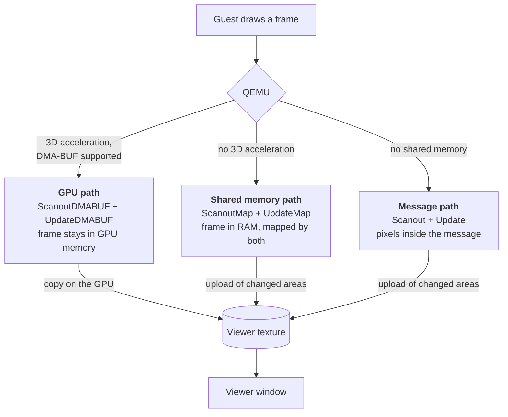
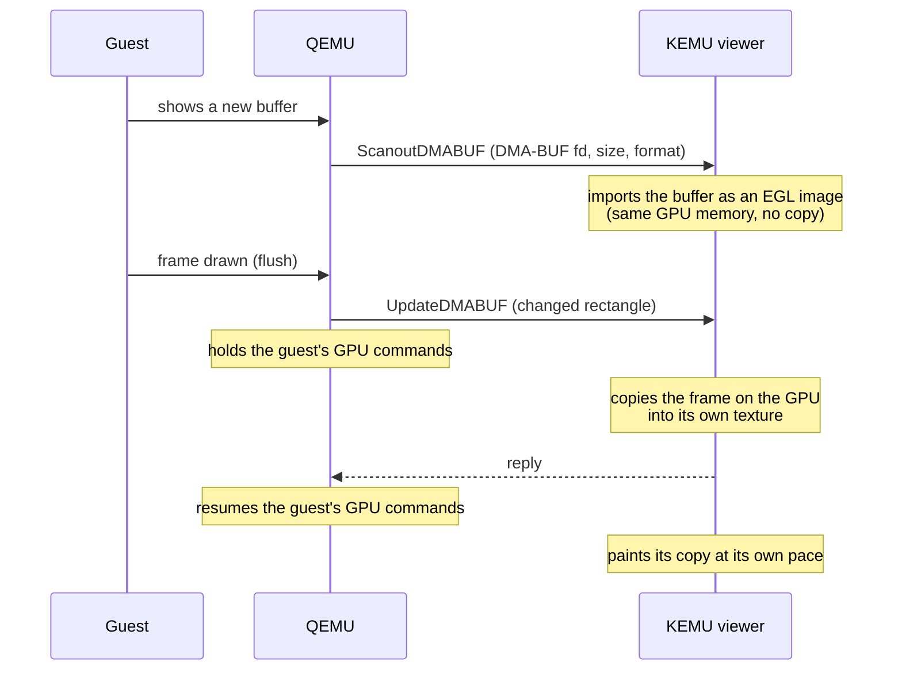

## How frames get from QEMU to the viewer

KEMU starts QEMU with `-display dbus,p2p=on`, plus `gl=on` with 3D acceleration. QEMU then talks to the viewer over a private D-Bus connection on a Unix socket. That socket carries small messages and file descriptors; the pixels themselves travel by one of three paths, depending on the VM and the host.

### GPU path (3D acceleration)

The guest renders through virglrenderer on the host GPU, so the finished frame is a texture in GPU memory. It never passes through the CPU.

- **ScanoutDMABUF** arrives whenever the guest's compositor switches to another buffer, usually with every page flip. QEMU exports the texture as a DMA-BUF, a kernel handle on GPU memory, and passes its file descriptor over the socket.
- **UpdateDMABUF** only names the rectangle that changed. QEMU pauses the guest's GPU commands until the viewer replies, so the guest cannot draw into the buffer while the viewer reads it. The viewer therefore copies the frame on the GPU and replies at once, before it paints.

### Shared memory path (no 3D acceleration)

Without 3D acceleration the guest's framebuffer lies in RAM.

1. **ScanoutMap** passes a file descriptor on that memory. The viewer maps it read-only, so both processes see the same pixels without a copy.
2. **UpdateMap** names the rectangle that changed. The viewer uploads just that rectangle from the mapped memory into its texture (`glTexSubImage2D`): one copy, from RAM to GPU memory.

If a VM has 3D acceleration but the viewer cannot take DMA-BUFs, QEMU uses this path too. It then first reads each frame back from the GPU into RAM, so the pixels cross the bus twice, which is noticeably slower.

### Message path (fallback)

Where shared memory is not available, **Scanout** and **Update** carry the pixels inside the D-Bus messages. The viewer stores them in an image of its own and uploads the changed areas from there.

### Everything else on the same connection

The connection also carries the mouse cursor (`CursorDefine`, `MouseSet`), keyboard, mouse and touch input from the viewer to QEMU, window size changes (`SetUIInfo`), and audio over a separate interface.
